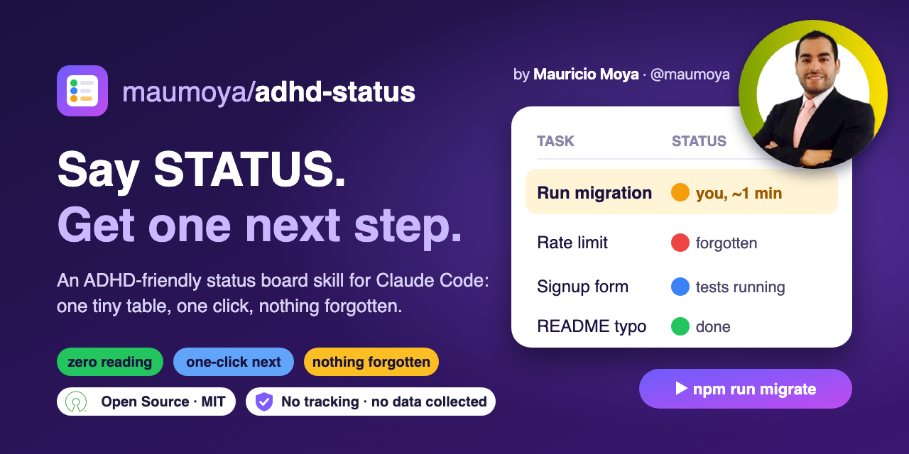
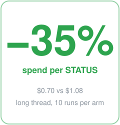

<p align="center">
  
</p>

<p align="center">
  
  
  <a href="#results-measured-2026-11-01"></a>
  <a href="#results-measured-2026-11-01"></a>
  
  <a href="https://opensource.org/license/mit"></a>
  <a href="PRIVACY.md"></a>
  <a href="https://scorecard.dev/viewer/?uri=github.com/maumoya/adhd-status"></a>
  <a href="https://www.bestpractices.dev/projects/16177"></a>
</p>

# adhd-status

**The free, open source ADHD-friendly status board for Claude Code and AI coding agents.** Say
`STATUS`, get one tiny table and one next step. Built for focus, executive function and context
management. MIT licensed.

**Measured:** catches a forgotten task **83% of the time vs 25%** without it, and spends **35% less
per STATUS** in a long thread because you rarely have to ask again
([results](#results-measured-2026-11-01)).

An open source skill for Claude Code (and other agents that read `SKILL.md` skills, the open Agent
Skills format) that turns **STATUS** into a zero-reading status board.

Say `STATUS` in any working session and you get:

- one tiny **Task | Why | Status** table (4 rows max, plain words, emoji status, time estimates on
  your-turn rows, wins shown as ✅)
- exactly **one** next action you can click or run
- nothing forgotten: the agent sweeps the whole conversation with a built-in completion check first, so
  promised-but-dropped work shows up as a row
- no "paste the output" or "tell me when done": the agent checks results itself
- **one task per thread**: new work goes to a new thread; a finished thread reports back to its
  parent thread, then compacts and closes
- **hub mode**: a `ROADMAP.md` file is the summary page of every task in flight. One hub thread
  keeps it (your existing roadmap thread if you have one, else the root thread); child threads
  update only their own row when they hand back; STATUS in the hub thread shows the top 4 rows
- a nudge to compact (at a milestone, never mid-fix) or start fresh when the conversation gets long

Built for ADHD brains, useful for anyone juggling several things in one session.

See [`examples/status-reply.md`](examples/status-reply.md) for a sample reply.

## Install

### One command (recommended)

Installs adhd-status as a personal skill, linked so `git pull` updates it. Nothing else is needed:
the completion sweep is built in.

```bash
mkdir -p ~/src ~/.claude/skills && git clone https://github.com/maumoya/adhd-status.git ~/src/adhd-status && ln -s ~/src/adhd-status/skills/adhd-status ~/.claude/skills/adhd-status
```

Restart Claude Code (or start a new session), then say `STATUS`.

### As a Claude Code plugin

```
/plugin marketplace add maumoya/adhd-status
/plugin install adhd-status@adhd-status
```

### As a plain skill

Claude Code loads personal skills from `~/.claude/skills/`.

```bash
git clone https://github.com/maumoya/adhd-status.git ~/src/adhd-status
ln -s ~/src/adhd-status/skills/adhd-status ~/.claude/skills/adhd-status
```

The symlink means `git pull` updates it. To copy instead, copy the `skills/adhd-status` folder to
`~/.claude/skills/`. For one project only, put it in that project's `.claude/skills/`.

## Use

Type any of these in a session:

```
STATUS
status?
where are we
what's left
```

## Tip: keep the board through compaction

Add this line to your project's `CLAUDE.md` so a `/compact` keeps what the board needs:

```
Compact instructions: keep every open task, its status, any command given to me, and the parent thread this one reports to.
```

## Test it (benchmark)

The `evals/` folder holds test cases in the format `claude plugin eval` reads. From this folder:

```bash
claude plugin eval . --scaffold --allow-tools Edit,Write,Bash
```

It runs each case with and without the skill and reports the score difference. These are real
model runs and are billed to your account.

### Results (measured 2026-11-01)

**Plugin eval** (6 cases, 2 runs each, `claude plugin eval`): overall score **0.95 with the skill vs
0.65 without**. The "forgotten item" case, where one promised task is buried in a long thread, was
caught **83% of the time with the skill vs 25% without**.

**Re-prompt cost** ([`bench/reprompt/`](bench/reprompt/), 10 episodes per arm, one ~13k-token
thread with 6 open items, the user asks again about each item the reply misses):



| Per STATUS, until every item is covered | With skill | Without |
|---|---|---|
| Average cost | **$0.70** | $1.08 |
| Median cost | $0.59 | $1.08 |
| Times the user had to ask again | **1.7** | 3.1 |
| Items right on the first reply | 4.5 of 6 | 3.9 of 6 |
| Episodes that never covered all 6 (6 turns) | **0 of 10** | 4 of 10 |
| Times it asked the user to paste or report | **2** | 23 |

The first reply costs about the same in both arms (~$0.23). The saving comes from fewer follow-up
turns: about **35% less spend per STATUS** in this test. In short, tiny eval threads with nothing to
forget, the skill's extra instructions make a single reply cost more; the payoff shows up in long
threads, where forgetting is likely.

Small sample, one synthetic thread, an LLM judge: a direction, not a guarantee. The harness and all
20 episode logs are in [`bench/reprompt/`](bench/reprompt/).

**Since then** (each tested against the previous version on the same day, 10 episodes per arm):

| Version | What changed | Measured vs the version before |
|---|---|---|
| 1.5.0 | row 4 names every hidden item; failures always get their own row | **28% less** spend per STATUS, 4.2 vs 2.9 items right on the first reply |
| 1.6.0 | reads log files before saying "can't verify" | **half** the re-asks (1.7 vs 3.6), runs that never covered everything 2 vs 4 of 10 |

The numbers above the table were measured on 1.4.x; 1.6.0 was not re-run against "no skill". Details
in [`bench/reprompt/README.md`](bench/reprompt/README.md).

## Security at a glance

The [OpenSSF Scorecard](https://scorecard.dev/viewer/?uri=github.com/maumoya/adhd-status) badge
at the top is an automated, independent check of how this repository is run. The skill itself is
one Markdown file: no code, no network calls, no data collected (see [PRIVACY.md](PRIVACY.md)).

| Check | Score | What it means here |
|---|---|---|
| Dangerous workflows, token permissions, pinned actions, vulnerabilities, binaries | 10 | CI cannot be hijacked by a pull request, tokens are read-only by default, every action is pinned to a commit |
| Code scanning (CodeQL), CI on pull requests | 10 | every change is scanned before it reaches `main` |
| Branch protection | 8 | `main` blocks force-push and deletion; changes need a pull request and a passing CodeQL check |
| Signed releases | 10 | each release ships with signed SLSA provenance (see below) |
| Code review | 0 | one maintainer, so no second person approves changes yet |
| Maintained | 0 | new repository; this check starts counting after 90 days |
| Fuzzing | 0 | there is no code to fuzz |

### Verify a release

Each [release](https://github.com/maumoya/adhd-status/releases) has the skill as a zip plus a
`*.intoto.jsonl` provenance file signed with Sigstore. Check it with
[slsa-verifier](https://github.com/slsa-framework/slsa-verifier):

```bash
slsa-verifier verify-artifact adhd-status-v1.6.0.zip --provenance-path adhd-status-v1.6.0.intoto.jsonl --source-uri github.com/maumoya/adhd-status --source-tag v1.6.0
```

## FAQ

**What is adhd-status?**
A free, open source (MIT) skill for Claude Code and other AI coding agents. When you say `STATUS`,
the agent replies with one tiny Task | Why | Status table and exactly one next step you can click
or run.

**Who is it for?**
Developers with ADHD, and anyone who loses track of tasks, pending commands or promises in long AI
coding sessions.

**Is it free and open source?**
Yes. MIT license, OSI-approved. Use it, fork it, change it.

**Which agents does it work with?**
Claude Code (as a skill or a plugin) and any agent that loads `SKILL.md` skills.

**How is it different from a todo list?**
The agent builds the board itself from the whole conversation, checks results on its own (no
pasting output), shows at most 4 rows and gives one next action, so there is nothing to read
through.

**Does it need anything else?**
No. It is one self-contained skill: the completion sweep that keeps anything from being missed is
built in.

## How this skill was launched

The whole publishing journey is public, with real numbers: OpenSSF Scorecard 5.9 → 7.4, Best
Practices passing, what is still open, and the measure → fix → re-measure loop to launch any skill.

- [Publishing playbook](docs/PUBLISHING_PLAYBOOK.md) (reads on GitHub)
- [Interactive progress page](docs/progress.html) with tick boxes (download and open, or view on the
  project site once it is live)

## Credits

- Time estimates, visible wins and the no-preamble rule are inspired by
  [i-have-adhd](https://github.com/ayghri/i-have-adhd) by Ayoub G. (MIT). It pairs well with this
  skill if you want every reply ADHD-shaped, not just STATUS.
- The completion sweep (re-read the asks, treat reports as claims, never call it done with a part
  missing) adapts ideas from [unlazy](https://github.com/Leonxlnx/unlazy) by Leonxlnx (MIT).

## About the author

Hi, I'm **Mauricio Alonso Moya Tapia** ([@maumoya](https://github.com/maumoya)). I built adhd-status
because I wanted AI coding sessions that tell me in one glance what is done and what is next, so
nothing gets lost.

Say hi or follow my work on [LinkedIn](https://www.linkedin.com/in/mba-mmoyat/).

## License

MIT. Copyright (c) 2026 Mauricio Alonso Moya Tapia.

The Open Source Initiative® logo is a trademark of the Open Source Initiative. Its use here only
marks that the MIT license is OSI-approved; it does not imply OSI endorsement of this project.
